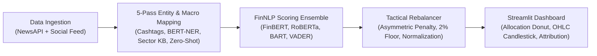

# AI/NLP Risk Engine: Tactical Index Rebalancer - S&P Global & Crisil Hackathon 2026

**Candidate Name:** AYUSH PATTANAIK

**College Email ID:** b424020@iiit-bh.ac.in

**College / Campus:** International Institute of Information Technology , Bhubaneswar (IIIT Bhubaneswar)

**Demo Video Link:** 

---

## 1. Project Overview / Problem Statement & Approach

Traditional stock indices and funds rebalance on rigid monthly or quarterly schedules, leaving portfolios exposed to sudden drawdowns when breaking news hits. When central banks shift interest rates or geopolitical conflicts disrupt energy supply, stock prices react within minutes. Relying on delayed calendar schedules or manual news monitoring causes missed reallocation windows and avoidable portfolio losses.

Furthermore, off-the-shelf NLP models struggle with financial nuance. Market impact is context-dependent—a rate hike hurts valuation multiples for high-growth tech stocks but benefits commercial bank margins. Additionally, financial text is packed with informal slang (*"to the moon"*, *"shorting hard"*), tricky dismissals (*"analysts shrugged off bubble fears"*), and indirect macro impacts where company tickers are never explicitly mentioned (e.g., crude bottlenecks impacting ExxonMobil).

To solve this, we built the **AI/NLP Risk Engine & Tactical Index Rebalancer**. The engine continuously ingests live financial news and social streams, resolves direct and indirect company exposures through a 5-pass pipeline (cashtags, BERT-NER, sector rules, and zero-shot NLI), and scores sentiment using a blended ensemble of FinBERT, RoBERTa, and VADER. It then tactically rebalances a 15-stock benchmark universe in real time using an asymmetric risk formula (penalizing downside risk 3× heavier than upside gains), maintains a 2% diversification safety floor, and re-normalizes weights to 100% inside an interactive Streamlit dashboard.

---

## 2. Architecture & Tech Stack

### System Design & Data Flow



### Key Frameworks & Libraries
- **Web UI & Charts:** `streamlit` (reactive dashboard), `plotly` (interactive donut, weight distribution, and candlestick charts)
- **Deep Learning & NLP:** `torch` (PyTorch backend), `transformers` (Hugging Face pipelines)
  - `ProsusAI/finbert` — Domain-specific formal financial news sentiment
  - `cardiffnlp/twitter-roberta-base-sentiment-latest` — Social media discourse and retail slang
  - `facebook/bart-large-mnli` — Zero-shot event categorization & directional market outlook
  - `dslim/bert-base-NER` — Token-level organization (`ORG`) and person (`PER`) entity extraction
  - `vaderSentiment` — Fast lexicon sentiment augmented with custom financial slang dictionary
- **Market Data & Utilities:** `newsapi-python` (live financial headlines), `yfinance` (real-time OHLC & 20-day SMA), `pandas`, `numpy`

---

## 3. Dataset Used

### Source & Nature of Sample Data
- **Live Financial News:** Ingested via NewsAPI across 20+ premier financial outlets (*Bloomberg, Reuters, WSJ, CNBC, FT*) targeting portfolio stocks and macro drivers.
- **Simulated Social Stream:** 15 synthetic micro-posts replicating Twitter/X retail chatter with cashtags (`$AAPL`, `$NVDA`) and financial slang (*"sell the rip"*, *"massive beat"*).
- **Macro Fallback Benchmark:** 15 curated high-impact headlines ensuring zero downtime during offline testing or API rate limits.
- **Market Price Data:** Live historical and daily OHLC prices with 20-day Simple Moving Average (SMA) overlays via Yahoo Finance (`yfinance`).

### Assumptions Made About the Data
- **Informational Lead Time:** Breaking news and sentiment shifts carry early directional signals before closing prices fully absorb the shock.
- **Asymmetric Risk Response:** Investors exhibit loss aversion; negative news reduces portfolio weights 3× harder than positive news increases them.
- **Index Baseline & Safety Floor:** Starts from an equal-weighted 15-stock benchmark ($6.67\%$ each) and enforces a mandatory $2.0\%$ minimum allocation floor to maintain diversification.

---

## 4. Quickstart & Installation

Runtime: Python 3.12 (or Python 3.10+) on Windows 11 / Linux / macOS

Step-by-step commands to set up the environment and run your code locally:
```bash
git clone https://github.com/AyuPat-97/AyuPat-97-IIIT-Bhubaneswar-Ayush-Pattanaik-Hackathon.git
cd AyuPat-97-IIIT-Bhubaneswar-Ayush-Pattanaik-Hackathon
python -m venv venv
# Windows: .\venv\Scripts\activate | Linux/macOS: source venv/bin/activate
pip install -r requirements.txt
streamlit run src/dashboard.py
```

---

## 5. Key Results & Domain Impact

### What the Prototype Demonstrates
- **Macro & Ticker Resolution:** Identifies affected portfolio assets even from macro headlines without explicit tickers (e.g., Persian Gulf energy tension $\rightarrow$ `XOM`).
- **Nuanced FinNLP Scoring:** Accurately scores sentiment without false reversals on slang or negation (*"shrugged off concerns"* correctly handled as non-bearish).
- **Zero-Shot Event Classification:** Categorizes events into 9 institutional buckets (Monetary Policy, Regulatory Risk, etc.) with a 1–10 impact severity score.
- **Real-Time Dynamic Rebalancing:** Reallocates index weights on the fly, tracks turnover, and classifies asset tilts (Overweight, Underweight, Neutral).
- **Interactive Scenario Sandbox:** Allows analysts to input hypothetical breaking news and observe real-time portfolio reallocations.

### Domain Impact (Why It Matters)
- **Downside Protection:** Hedges at-risk holdings immediately during market shocks rather than waiting for lagged calendar rebalancing dates.
- **Automates Research:** Replaces hours of manual headline scanning and ticker correlation with an automated, sub-second quantitative pipeline.
- **Explainable & Auditable:** Every portfolio adjustment provides a transparent audit trail linking the source headline, extracted entities, sentiment score, and mathematical weight shift.
